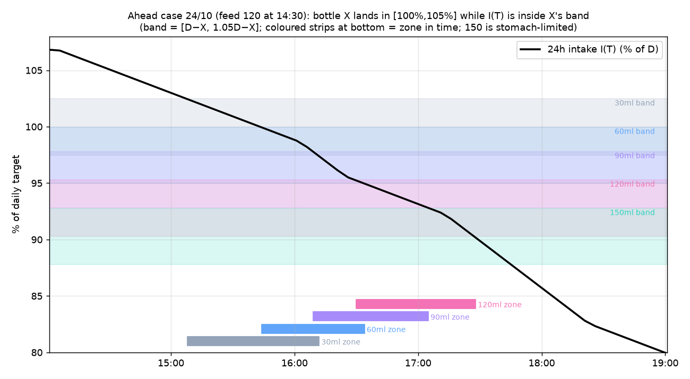
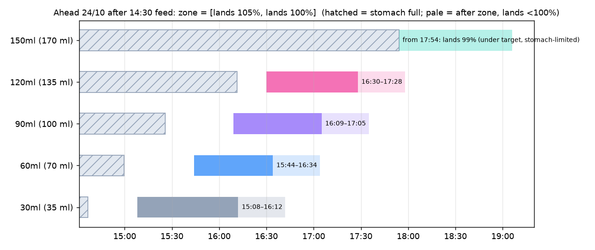
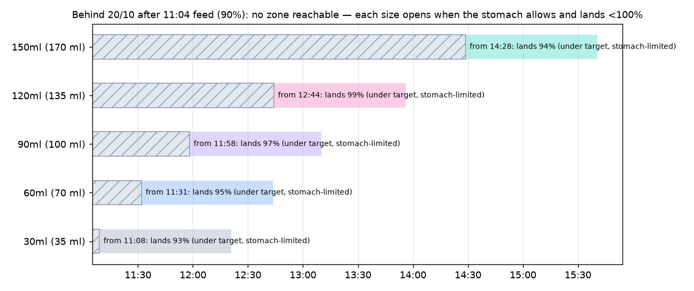
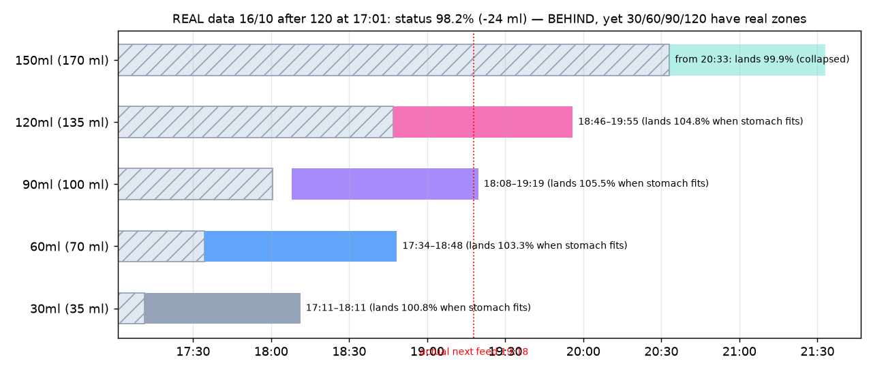
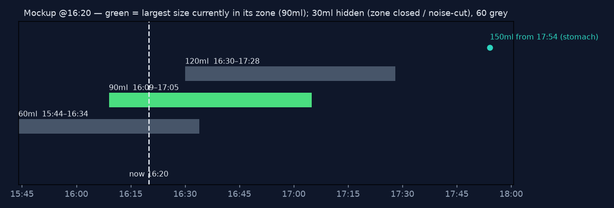
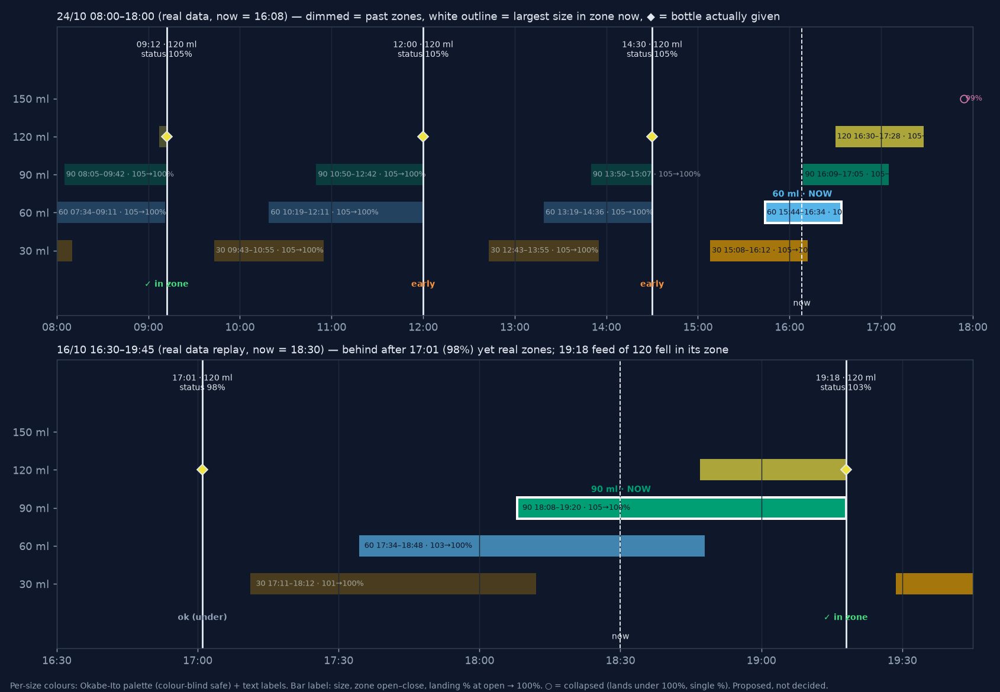
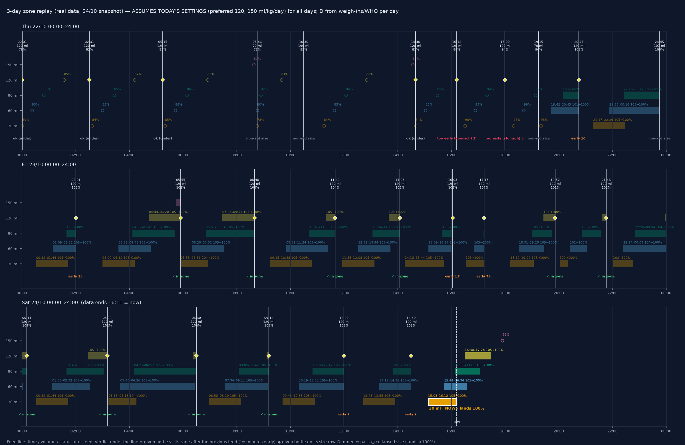

# Feeding zones instead of point-in-time markers

**Status:** Brainstorm / for discussion — no code change
**Date:** 2026-10-25 · **Author:** Grok Bot for Koen · **Applies to:** web (`baby-milk-tracker` 1.1.56, `e72acd1`) and mobile (`milkwise` 1.2.9, `e0020e3`)
> **Correction (2026-10-25, credit: Koen).** The first version of this doc claimed that *when the baby is behind there are no real zones — every size lands under 100 %*. Koen challenged this ("a 90 bottle at the time the stomach allows it could push her to 103 %"), and he is right: being behind at the last feed (I < D) says nothing about I(S)+B at the stomach-fit time S. The ahead/behind split has been replaced by one per-bottle rule (§3.2–3.4), and a scan of the real feed history (§4.3) shows real zones while behind after **~24 % of the 'behind' feeds**. The 20/10 example is now labelled as a case where all zones *happened* to collapse.

**Related:** [next-session-predictor-design-v3.md](next-session-predictor-design-v3.md) §4, §7, §8.7 · [sonnet-review-calculation-audit.md](sonnet-review-calculation-audit.md) · Notion *!Milkwise* "Milk Balance" / Predictor 3

All times are Europe/Brussels. Numbers were produced with the real web `calculations.ts` (vendored copy, byte-identical to `main`) by `verify_zones.ts` (see §9).

---

## 1. Problem

The Feeding Timeline (`src/components/cards/CanTakeCard.tsx`) shows one **point in time** per bottle size and mixes two different thresholds:

| What | Where | Threshold |
|---|---|---|
| Green "Give now" | `calculations.ts:491` (`intakeReadyAtMs`) | giving the bottle keeps status **≤ 105 %** |
| Future (rose/teal) markers | `calculations.ts:495-506` (binary search) | intake has decayed so the bottle lands at **100 %** |
| Grey "ghost" markers | `CanTakeCard.tsx:57-80, 134-160, 304-332` | **100.5 %** (display rounding), measured from the last feed |

Consequences observed on 24/10 (see the 2026-10-24 timeline analysis):

- *"60 now, 30 at 16:08, 60 twice"* — the advised size gets both a ghost and a green marker (`:306-322`); fitting sizes below green are not noise-cut (v3 §7.2).
- The future markers say 90 at 17:04 and 120 at 17:27, but green silently jumps to **90 at 16:09** and **120 at 16:30**, because green uses 105 % and the markers use 100 %.
- The mismatch matters whenever a bottle can land above 100 % at the moment it fits the stomach — usually when ahead, but also in roughly a quarter of the *behind* situations (§4.3). Only when every zone collapses (e.g. 20/10, §4.2) do all three rules coincide.

Koen's direction (2026-10-25): 100 % is the most consistent rule, drop the ghosts — but first explore **zones**.

## 2. Proposal in one paragraph

For every bottle size X, show a **zone in time** rather than a point: the zone **opens** when giving X would land the status at **105 %** (the top of the green band, and never before the stomach can hold X) and **closes** when giving X would land at exactly **100 %** (the ideal). Inside the zone, X is a good choice; the close is the "ideal" moment (= today's 100 % marker). Zones of neighbouring sizes **overlap**, so at most moments two sizes are acceptable; the app highlights the size in zone whose landing % now is **closest to 100 %** (decided, §10).

## 3. Maths

Notation (all in *formula* ml): D = daily target (`dailyTargetMl`), r = D/24 (`hourlyRate`), I(T) = `smoothedAtTime(feeds, r, T)` = Σ `bottleCredit(age, milk, r)`, B = `waterToMilk(X)`.

### 3.1 I(T) is non-increasing between feeds

`bottleCredit` (`calculations.ts:97-108`) is `milk` for age ≤ 24 h and `max(0, milk − r·(age−24))` after. Each term is constant then linearly decreasing then 0, so I(T) is **continuous, piecewise linear and non-increasing** as long as no new feed is added. Its slope is `−r · n(T)` where n(T) = number of feeds that are older than 24 h but still have credit left (usually 1, sometimes 2 → steeper; 0 → flat plateau).
Numerically verified: max rise of I over one-minute steps across 10 h = **0.000000 ml** in both snapshots.

### 3.2 Zone of bottle X — one rule, no ahead/behind split

```
L(T)     = I(T) + B                                  formula in the stomach-free "status after giving X at T"
S        = stomachFits(X)  = stomachReadyAtMs(...)   (calculations.ts:442, cap = steady-state peak × 1.1)
t105     = first T ≥ now with L(T) ≤ 1.05·D
t100     = first T ≥ now with L(T) ≤ D
open(X)  = max(S, t105)
close(X) = t100
```

**Claim.** With no new feed, X has a real zone `[open, close)` **iff `L(S) > D`, i.e. `I(S) + B > D`**. Otherwise the zone is *collapsed*: X is available from S and lands at `L(S)/D ≤ 100 %`, and the bottle can never land at 100 % or above afterwards.

**Proof.** By §3.1, I — hence L — is non-increasing in T. (i) If L(S) > D, then t100 > S (L has not yet reached D at S), and t105 ≤ t100 (a non-increasing function reaches 1.05D before D), so open = max(S, t105) < t100 = close: a non-empty interval, on which D < L ≤ 1.05D. If moreover L(S) ≤ 1.05D, then t105 ≤ S and the zone **opens at S** ("fits the stomach and already lands within 105 %"). If L(S) > 1.05D, it opens later, at t105. (ii) If L(S) ≤ D then t100 ≤ S ≤ open, so the interval is empty; for every T ≥ S, L(T) ≤ L(S) ≤ D. ∎

**Consequence for 'behind'.** "Behind" (I(t_feed) < D right after the last feed) only means I < D; it does not bound I(S) + B. A real zone despite being behind needs the remaining deficit at S to be smaller than the bottle: `D − I(S) < B`. Because I is **flat** while no feed is older than 24 h (n = 0 in §3.1), the deficit often does not grow during the stomach wait, so this happens regularly.

### 3.3 Overlap condition (exact, slope-independent)

For B1 < B2, zone 2 opens when I ≤ 1.05D − B2; zone 1 closes when I ≤ D − B1. Since I is non-increasing, zone 2 opens **before** zone 1 closes iff

```
1.05·D − B2  >  D − B1      ⇔      B2 − B1  <  0.05·D
```

This is exact in *intake level*, so it holds regardless of the piecewise slope (1 or 2 decaying feeds). Caveats: (i) on a plateau (n = 0) levels hold for a while, so a zone can last longer but the overlap test is unchanged; (ii) the stomach can delay `open(X2)` past `close(X1)` — then overlap is lost (that is what happens to 150 on 24/10).

With D ≈ 1390 ml, 0.05·D ≈ **69.5 ml** (69.1 on 20/10). Formula table 35, 70, 100, 135, 170, 200, 240:

| Pair (water) | ΔB (formula) | Overlap? |
|---|---|---|
| 30–60 | 35 | yes |
| 60–90 | 30 | yes |
| 90–120 | 35 | yes |
| 120–150 | 35 | yes (intake), but stomach usually cancels it |
| 150–180 | 30 | yes (intake) |
| 180–210 | 40 | yes (intake) |
| 30–90 | 65 | yes, barely (~3 min on 24/10) |
| 60–120 | 65 | yes, barely (~4 min) |
| 90–150 | 70 | **no** (70 > 69.5) |
| 120–180 | 65 | yes (intake) |
| 150–210 | 70 | **no** |

So **every neighbouring pair overlaps** and some next-but-one pairs overlap a few minutes. This is weight-dependent: at D < 700 ml (≈ 4.7 kg) the 35-ml steps stop overlapping; for a bigger baby overlaps grow. Koen's intuition ("while 90 goes from 105 now to 100 later, 120 kicks in at 105") is **mathematically correct**.

### 3.4 Behind vs ahead — only a matter of which case of §3.2 applies

There is no separate behind rule. Per bottle: real zone if `I(S)+B > D`, collapsed otherwise. When behind, small bottles and long stomach waits tend to collapse; bottles with `B > D − I(S)` get a real zone exactly as in the ahead case.
Note on v3 §8.7: for a *collapsed* bottle, waiting indeed never helps (L only decreases), so §8.7's goal "wait until X lands at 100 %" is unreachable for that bottle; for a non-collapsed bottle the 100 % time is simply `close(X)`. Either way §8.7's algorithm equals the 100 % rule.

### 3.5 Sizes above preferred + 1, stomach cap

`canTakeProgression` shows sizes up to preferred + 1 (120 → 150). 180 (200 ml) and 210 (240 ml) exceed `stomachCapMilk × 1.1` (≈ 185 ml); `stomachReadyAtMs` then requires near-empty stomach (`:465-470`). Proposal: keep the preferred + 1 ceiling; compute zones only for those sizes.

## 4. Worked examples (real snapshots)

### 4.1 Ahead — 24/10, after 120 at 14:30 (status 105.1 %, D = 1390.2, r = 57.93 ml/h)

| Size | Stomach fits | Lands 105 % | Lands 100 % | Zone |
|---|---|---|---|---|
| 30 (35) | 14:36 | 15:08 | 16:12 | **15:08–16:12** |
| 60 (70) | 14:59 | 15:44 | 16:34 | **15:44–16:34** |
| 90 (100) | 15:25 | 16:09 | 17:05 | **16:09–17:05** |
| 120 (135) | 16:11 | 16:30 | 17:28 | **16:30–17:28** |
| 150 (170) | 17:54 | 17:06 | 17:46 | collapsed: from 17:54, lands 98.8 % |

Overlaps: 30/60 28 min, 60/90 25 min, 90/120 35 min, 30/90 3 min, 60/120 4 min. The 100 % column matches Koen's checks (90 at 17:05, 120 at 17:27/28, 150 at 17:54).



*Figure A — I(T) as % of D. Bottle X lands in [100 %, 105 %] while I(T) is inside X's band [D−B, 1.05D−B]. Bands of neighbours overlap vertically ⇒ zones overlap in time.*



*Figure B — zones per size, ahead case. Hatched = stomach full; solid = zone; pale tail = after close (lands < 100 %).*

### 4.2 Behind, all zones happened to collapse — 20/10, after 120 at 11:04 (status 90.1 %, −137 ml, D = 1382.3)

| Size | Stomach fits | Lands at that moment | Zone |
|---|---|---|---|
| 30 | 11:08 | 92.6 % | collapsed (under target) |
| 60 | 11:31 | 95.1 % | collapsed |
| 90 | 11:58 | 97.3 % | collapsed |
| 120 | 12:44 | 98.9 % | collapsed |
| 150 | 14:28 | 94.1 % | collapsed |

Here every size collapses, **not because she is behind but because the deficit is larger than every bottle at its stomach time**: D − I(S) ≥ 137 ml vs B = 35…135 ml for 30…120; for 150 (170 ml) the 3 h 24 min stomach wait lets I decay further (14:28: deficit ≈ 250 ml), so it also lands under 100 % (94.1 %).



*Figure C — 20/10: a behind case in which every zone collapsed (deficit > bottle at stomach-fit time).*

### 4.3 Behind with real zones — real feed history scan

`scan_behind_zones.ts` replays every feed since data start (31/05/2026, 1142 feeds; first 24 h skipped), with the weight/D valid on that day and the current preferred size 120 (so sizes 30–150). For each feed whose post-feed status was < 100 %, it checks each size for `I(S)+B > D` with S before the actual next feed.

| Snapshot | Feeds evaluated | Behind after feed | Behind *with* ≥1 real zone | Share |
|---|---|---|---|---|
| 24/10 | 1131 | 847 | **203** | 24.0 % of behind · 17.9 % of all |
| 20/10 | 1094 | 827 | 202 | 24.4 % · 18.5 % |

Real zones by size (24/10): 30: 94 · 60: 163 · 90: 186 · 120: 149 · 150: 3. (Caveat: preferred size was not always 120 historically.)

Example 1 — **16/10 17:01, 120 given, status 98.2 % (−24 ml)**: 30 zone 17:11–18:11 (lands 100.8 % when it fits), 60 17:34–18:48 (103.3 %), **90 18:08–19:19 (lands 105.5 % at 18:00 → opens at 105 % at 18:08 and closes at 100 %)**, 120 18:46–19:55 (104.8 %), 150 collapsed (99.9 %). Actual next feed 19:18 — inside the 90 and 120 zones. This is exactly Koen's scenario.

Example 2 — **22/10 19:15, 70 ml, status 96.0 % (−56 ml), intake flat for the next hour**: 60 zone 19:42–20:44 (lands 101.0 %), 90 20:08–21:15 (103.2 %); 30 and 150 collapsed; 120's zone (lands 104.0 % at 20:54) starts after the actual next feed at 20:45.



*Figure E — real data 16/10: behind after the feed, yet 30/60/90/120 have real zones.*

## 5. UI options



*Figure D — mockup at 16:20 on 24/10: bars per size, now line, green = largest size whose zone contains now (90); 60 grey (also in zone); 30 hidden (zone closed); 120 upcoming; 150 shown as a stomach point.*

Rules proposed for discussion:

1. **Highlighted size (decided 2026-10-25, §10)** = among sizes whose zone contains now, the one whose landing % right now is **closest to 100 %** (= nearest its zone close); tie → the larger size. If no zone contains now: the **largest collapsed size that already fits the stomach** (it lands closest to 100 % from below), labelled "under target". Otherwise nothing is highlighted and the next zone opening is shown.
2. **Noise-cut**: hide sizes whose zone is past, and optionally smaller sizes in zone (show only green + upcoming).
3. **Labels**: bar from open to close; label `90 · 16:09–17:05`, with the close marked as "ideal".
4. **No ghosts** — the bar's left end already says "since when".
5. Alternative compact view: keep points but show only the *ideal* (close) time, with a small "ok from 16:09" sub-label.

## 6. Edge cases

- **Stomach-limited**: open = stomachFits; if ≥ close → collapsed zone (show as a point with "lands p %").
- **Behind**: no special case — per bottle, real zone or collapsed (§3.2). If *all* fitting sizes are collapsed, possibly show "behind — give the largest size that fits".
- **Right after a feed**: everything is in the future; first zone opens when the stomach allows and intake ≤ 1.05D − B.
- **Deep overfeed**: zones can be > 48 h away → reuse the 48 h cap from `intakeReadyAtMs` and show "later".
- **Plateau (n = 0)**: zones stretch; no change to rules.
- **DST / time zone**: all arithmetic is in epoch ms, so zones are exact across the DST switch (25/10 03:00 → 02:00 today); only labels and the hour ruler use local time (`fmtTime`, `fmtHour`). Check the ruler (`CanTakeCard.tsx:241-245` assumes `t % HOUR_MS === 0` is a full hour, which is only true in UTC-aligned offsets — fine for whole-hour offsets).
- **Weight/target changes** (WHO weight at `startOfToday`): D changes at midnight → zones shift; recompute every render (already happens every minute, `page.tsx:109`).

## 7. Impact on invariants

- "Give now never leads to > 105 %" (`calculations.ts:491`) becomes the **zone open bound** — same guarantee, now explicit and documented.
- "Markers are 100 % times" (v3 §7.1, Notion Predictor 3) becomes the **zone close**.
- Ordering (v3 §7.2): open and close are both monotonic in B (larger B needs lower I), except the stomach may push a bigger size later — still monotonic since stomachFits is also increasing in B. The ascending clamp (`CanTakeCard.tsx:149-158`) becomes unnecessary.

## 8. Code impact (when/if adopted)

- `calculations.ts` (web `:477-551`, mobile `:417-480`): add `intakeZone(feeds, B, r, D, now) → { openMs, closeMs, landingAtOpenPct, state }`; `canTakeProgression` returns zones; `fitsNow` = `open ≤ now < close`, or collapsed and `S ≤ now`.
- Remove `ghostIntakeReadyAtMs` (web `CanTakeCard.tsx:57`, mobile `calculations.ts:202`) and the ghost map (web `:134-160`, mobile `DashboardScreen.tsx:215-229`).
- Rendering: web `CanTakeCard.tsx:303-345`, mobile `DashboardScreen.tsx:257-269` → bars.
- Docs: v3 §7 rewritten; §8.7 rewritten (see §3.4).

## 9. Reproduction

Verifier (outside the repo, read-only): `/workspace/milkwise-verify/verify_zones.ts <db> <ISO time> <out.json>`; charts by `zones/plot.py`, `zones/plot_history.py` (+ `history_zones.ts`) and `zones/plot_behind_real.py`; history scan `scan_behind_zones.ts <db> <out.json>`. Snapshots `milkwise-data-20261024-161114` (ahead, ref 14:31) and `milkwise-data-20261020-111441` (behind, ref 11:05).

## 10. Decisions

| Date | Decision | By |
|---|---|---|
| 2026-10-25 08:45 CET | **Zone-open bound stays at 105 %** — it coincides with the yellow status band (`yellowThresholdPct` = 5), so "zone open" = "giving it now just stays out of yellow". | Koen |
| 2026-10-25 08:52 CET | **Highlight = size whose landing % is closest to 100 %** when several zones contain now (i.e. the one nearest its zone close). Tie-break: larger size. Collapsed sizes only take part when no zone contains now: then the largest collapsed size that fits the stomach is highlighted ("under target"). Used in Figures D, F, G. | Koen |
| 2026-10-25 09:54 CET | **Highlight rule confirmed: stays 'closest to 100 %'** after reviewing Issue 1 below (small-bottle drift, e.g. 30 ml at 16:11). Alternative 'largest size in zone' rejected. | Koen |
| 2026-10-25 08:45 CET | **Ceiling stays at preferred + 1 size** (120 → 150); larger sizes get no zone. | Koen |
| 2026-10-25 (earlier) | Direction: 100 % is the consistent "ideal" rule (zone close); ghost markers to be dropped. | Koen (leaning, confirmed by this design) |

## 11. Proposed UI refinements (ideas from Koen, 2026-10-25 — proposed, not decided)



*Figure F — real data. Top: 24/10 08:00–18:00, now = 16:08. Bottom: 16/10 16:30–19:45 replayed with now = 18:30 (the behind-with-real-zones example of §4.3). Dark app style, per-size colours, start-% labels, feed lines, now line.*

**11.1 One fixed colour per bottle size.** Every size keeps the same colour everywhere (timeline, history, settings, feed list). Proposed palette: Okabe-Ito, which stays distinguishable for the common colour-vision deficiencies — 30 orange `#E69F00`, 60 sky blue `#56B4E9`, 90 bluish green `#009E73`, 120 yellow `#F0E442`, 150 reddish purple `#CC79A7` (180/210 would get blue `#0072B2` / vermillion `#D55E00` if ever shown). Colour is never the only cue: bars always carry the size label.
*Conflict with "green = can take now":* green would then just be "the 90 colour". Proposal: "now" becomes **emphasis on the size's own colour** — full saturation + white outline (or glow) + a bold label "90 ml · NOW" — while other bars are drawn at reduced opacity. Exactly one size gets the emphasis, chosen by the closest-to-100 % rule (§5 rule 1, decided 2026-10-25). The status card keeps its green/yellow/red semantics; the timeline no longer uses green as a state.

**11.2 Starting percentage on each bar.** Label: `90 ml 16:09–17:05 · 105→100%`. The start % is the landing status when the zone opens: 105 % if the 105 % bound opens it, or the lower stomach-limited value (e.g. `102→100%`) when the stomach opens it. Collapsed sizes show a single landing value as a ring marker (e.g. `○ 94%`). The status at each feed line is printed under the feed label ("status 105%").

**11.3 Keep the past: continuous history.** The timeline becomes continuous. Each actual feed is a solid vertical line labelled with time + volume (+ status after the feed); it *cuts* all zones, and a fresh set of zones starts after it (zones are recomputed with that feed included). Past zones stay, dimmed. The bottle actually given is marked (◆) on its own size row, and the feed gets a verdict against the zone computed after the previous feed:

- **in zone** — fed between open and close of that size;
- **early** — before the zone opened (would land > 105 % or stomach not yet ready);
- **late** — after the zone closed (landed < 100 %);
- **ok (under)** — that size was collapsed (could only land under 100 %) and was given after it fitted.

On 24/10 the verdicts were: 09:12 ✓ in zone, 12:00 early, 14:30 early. On 16/10: 19:18 ✓ in zone (despite being behind at 17:01). This makes advice-vs-reality auditable at a glance.

**11.4 Data needed for historic replay.** Feeds (`feeds.json`, timestamped) and weigh-ins (`weights.json`, timestamped → measured / WHO weight per day, hence D) are stored, so zones can be replayed. **Not stored historically:** `preferredBottleWaterMl`, `mlPerKgPerDay`, the yellow/red thresholds, and DOB/sex edits — `settings.json` only holds current values. Replay therefore uses today's settings (the mockups use preferred = 120 throughout; the history scan in §4.3 has the same caveat). Options: (a) accept it (most settings rarely change); (b) store a small `settingsHistory` (timestamp + changed keys) on every settings save; (c) snapshot the computed zones / advice at each feed (`feed.adviceSnapshot`), which also captures app-version changes. Also note that editing or deleting a past weigh-in changes replayed history.

## 11b. Three-day replay (22/10 00:00 – 24/10 16:11)



*Figure G — one panel per day, real data from the 24/10 snapshot. **Assumes today's settings** (preferred 120, 150 ml/kg/day, thresholds 5/10 %) for all three days — settings history is not stored (§11.4); D per day from weigh-ins/WHO. Highlight at now (16:11) per the decided rule.*

| Feed | ml | Status after | Verdict (vs zone after previous feed) | Min early (−) / late (+) |
|---|---|---|---|---|
| 2026-10-22 00:01 | 120 | 77.9% | collapsed-ok | 0 |
| 2026-10-22 02:31 | 120 | 81.5% | collapsed-ok | 0 |
| 2026-10-22 05:15 | 120 | 82.8% | collapsed-ok | 0 |
| 2026-10-22 08:46 | 70 | 75.1% | non-standard | 0 |
| 2026-10-22 10:30 | 199 | 85.0% | non-standard | 0 |
| 2026-10-22 14:40 | 120 | 81.3% | collapsed-ok | 0 |
| 2026-10-22 16:12 | 120 | 87.7% | early(stomach) | -2 |
| 2026-10-22 18:00 | 120 | 93.7% | early(stomach) | -5 |
| 2026-10-22 19:15 | 70 | 96.0% | non-standard | 0 |
| 2026-10-22 20:45 | 120 | 104.7% | early | -10 |
| 2026-10-22 23:45 | 107 | 104.6% | non-standard | 0 |
| 2026-10-23 02:01 | 120 | 105.9% | early | -15 |
| 2026-10-23 05:55 | 120 | 101.7% | in-zone | 0 |
| 2026-10-23 08:40 | 120 | 104.5% | in-zone | 0 |
| 2026-10-23 11:40 | 120 | 103.6% | in-zone | 0 |
| 2026-10-23 14:05 | 120 | 103.2% | in-zone | 0 |
| 2026-10-23 16:03 | 120 | 105.9% | early | -11 |
| 2026-10-23 17:13 | 120 | 107.4% | early | -39 |
| 2026-10-23 19:52 | 120 | 101.3% | in-zone | 0 |
| 2026-10-23 21:46 | 120 | 101.6% | in-zone | 0 |
| 2026-10-24 00:11 | 120 | 103.9% | in-zone | 0 |
| 2026-10-24 03:11 | 120 | 102.0% | in-zone | 0 |
| 2026-10-24 06:30 | 120 | 104.4% | in-zone | 0 |
| 2026-10-24 09:12 | 120 | 104.6% | in-zone | 0 |
| 2026-10-24 12:00 | 120 | 105.4% | early | -7 |
| 2026-10-24 14:30 | 120 | 105.1% | early | -2 |

Totals (26 feeds): in zone 10 · early 8 (6 vs the 105 % bound, 2–39 min; 2 "too early for the stomach", 2 and 5 min) · late 0 · ok-under 4 · non-standard size 4 (70, 199, 70, 107 ml).

### Issues found — does the zone logic work well?

1. **[Decided 2026-10-25 09:54 CET: keep closest to 100 %, §10]** **The highlight walks up the sizes and may advise a tiny bottle.** With closest-to-100 %, the highlight is effectively "the smallest size still in zone": on 24/10 it goes 30 (until 16:12) → 60 (until 16:34) → 90 (until 17:05) → 120. At 16:11 it advises **30 ml** although 60 and 90 are also in zone. The *switch times* equal Koen's expected 100 % times of the next-smaller size (nice: monotonic, never goes back), but a parent seeing "30 now" may under-feed. Possible refinements: restrict the candidates to sizes ≥ the last feed size − 1 step, or show the highlight as "best now" plus the preferred-size zone.
2. **Deep-behind day (22/10, 78–88 %).** Almost every size collapsed all day; the timeline is a field of rings (○) with no bars — readable but uninformative. Collapsed rings only say "fits from S, lands p %"; a short bar from S to the next feed might read better (open question 2).
3. **Non-standard volumes (70, 199, 107 ml)** cannot be judged against a zone (no row); 199 ml is above preferred + 1 and above the stomach cap × 1.1 (~185 ml) — the zone model has nothing to say about it. Proposal: snap to the nearest standard size for the verdict, or show "non-std".
4. **Early feeds are common (8/26), mostly 2–15 min** — practically on time. A tolerance (open question 7) would turn most into "in zone". The 39-min early feed (23/10 17:13, 70 min after 16:03) is a top-up and correctly flagged.
5. **Clutter on normal days.** 4–5 overlapping bars between feeds; with labels above bars the 3-day view at 24 h width is dense but readable at phone width only for ≤ 8 h windows. Proposal: in the app show only the current period plus dimmed past, scrollable, and hide labels of past zones.
6. **Night feeds** behave like day feeds (no special case needed); zones are just as valid at 02:00. Status at night feeds was 102–106 % on 23–24/10: the night feeds were on time or slightly early.
7. **Status ≥ 105 % right after a feed** (e.g. 105.9 %, 107.4 %) is consistent with "early" verdicts — the rule correctly explains the yellow status.
8. **Settings assumption** — replay before a settings change would be wrong; see the companion design *settings history* (separate PR).

## 11c. Classic timeline (alternative view) — Koen amendment 2026-10-25 10:05 CET

Koen, verbatim: *"Also fix the current timeline (100% only and remove the grey future points) and keep it as an alternative timeline view to be selected in the settings of the app"*

1. **Fix the existing point-in-time timeline — 100 % only.** `intakeReadyAt` / readiness uses a single 100 % threshold. This removes the mixed rule where "give now" is checked at 105 % but the ready time is binary-searched at 100 % (`calculations.ts:491-506`).
2. **Remove the grey ghost/future markers** (`CanTakeCard.tsx:304-332`) and the sort that orders them (`:347`).
3. **Kept as an alternative to the zones timeline, chosen in the app settings.** Reuse the existing display-only key `feedingTimelineView` (already in the `settings.json` allowlist, PR #6 `PERSISTED_KEYS`) — no new key. Current type: `'timeline' | 'cards'`, default `'timeline'` when absent (`page.tsx:393`, `settings/page.tsx:241-243`); `'timeline'` = `CanTakeCard.tsx`, `'cards'` = `FeedingTimelineCards.tsx`. Proposal: add `'zones'` and make it the **default**; `'timeline'` becomes the fixed classic view; `'cards'` stays unless Koen drops it. Existing stored `'timeline'` values: migrate to `'zones'` once, or treat absent as `'zones'` (to decide at implementation).
4. **Scope:** both products — web (`baby-milk-tracker`) and RN (`koenswings/milkwise`); version bump in both. The `calculations.ts` change is shared and goes through the **MilkWise Design Review** before implementation.
5. **Invariant wording:** the "`intakeReadyAt` ≤ 105 %" invariant becomes 100 % for the classic view (105 % stays only as the zone-open bound). **The invariants doc must be updated** to reflect this.

## 12. Open questions for Koen (remaining)

1. Collapsed sizes when behind: show as ring + % (proposed), or as a short bar from S?
2. Smaller sizes that are also in zone: show dimmed (as in Figure F) or hide (noise-cut)?
3. Bars (Figures D/F) or points with "ok from" sub-labels?
4. Palette: Okabe-Ito as proposed, or app-brand colours checked with a colour-blind simulator?
5. How much past to keep visible (since midnight, last 24 h, scrollable all)?
6. Verdict tolerance: should "early/late" by a few minutes count as in zone (e.g. ±10 min)?
7. Historic replay: accept current settings, or add `settingsHistory` / per-feed advice snapshots (§11.4)?

*Closed: upper bound (105 %, §10) · ceiling (preferred + 1, §10) · highlight rule (closest to 100 %, §10).*
